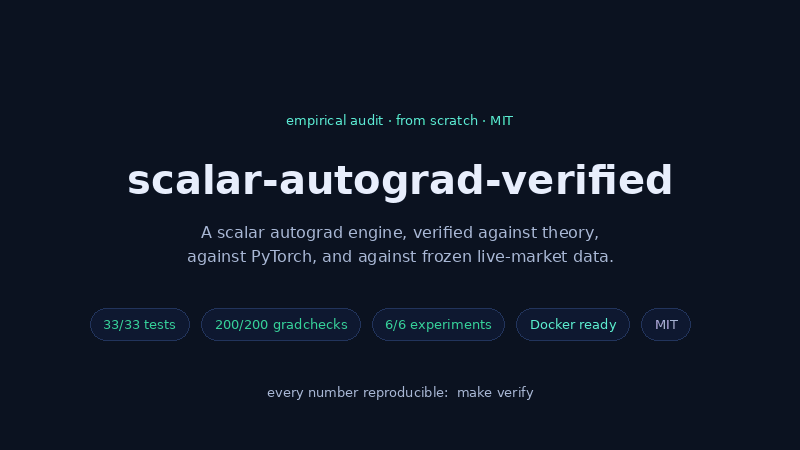
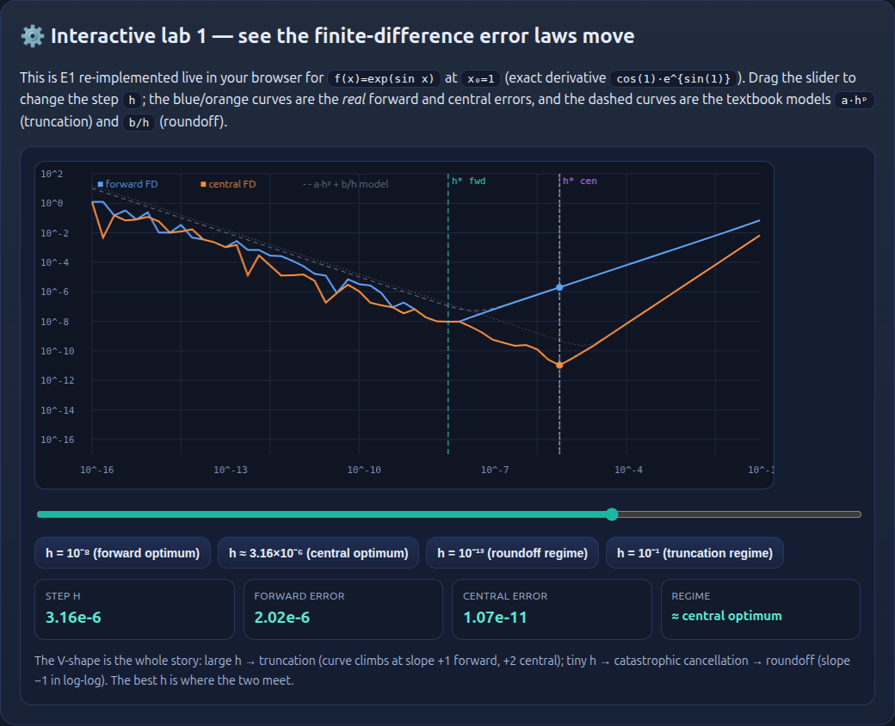
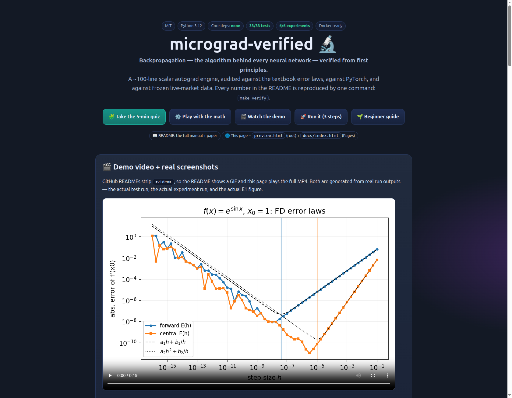
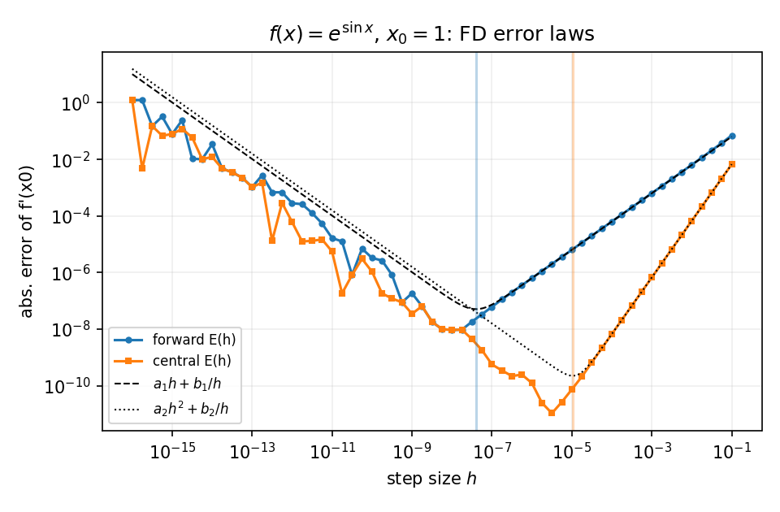

# micrograd-verified

[](LICENSE)
[](pyproject.toml)
[](tests/)
[](results/summary.json)
[](pyproject.toml)
[](docker-compose.yml)
[](data/SOURCES.md)

**An empirically verified scalar autograd engine: finite-difference error laws, aliasing-bug forensics, live-market gradient checks, and cross-process reproducibility.**

*A verification study of scalar reverse-mode automatic differentiation, in the tradition of Karpathy's [micrograd](https://github.com/karpathy/micrograd) — re-derived from first principles, then audited against theory, against PyTorch, and against frozen live financial data. Every number in this README is reproduced by `make verify`; raw evidence lives in [`results/*.json`](results/).*

**Snapshot:** 2026-10-17 · Python 3.12.13 · NumPy 2.2.6 · PyTorch 2.13.0+cu130 · 33/33 tests passing · 6/6 experiments verified.

---

> **CEO summary (30 seconds):** Backpropagation trains every neural network on Earth. This repo rebuilds it
> from scratch in ~100 lines — then does what tutorials don't: it **audits it**. Six experiments reproduce
> the textbook finite-difference error laws (slopes **+1.006 / +1.9998**, r² = 1.0000), verify gradients on
> **200/200** random programs against PyTorch's own criterion, quantify the classic `=` vs `+=` aliasing bug
> (**64%** of random graphs corrupted, **100%** of those caught), check real BTC/ETH/FX losses (null result
> reported honestly), prove cross-process bitwise reproducibility, and benchmark scalar-per-node cost (≈4×
> faster than scalar PyTorch tensors). One command reproduces everything: `make verify` — **33/33 tests,
> 6/6 experiments green**. Open [`preview.html`](preview.html) for the interactive tour: demo video, a live
> error-law lab, and a 12-question quiz from zero to pro.

**🌐 Live interactive site:** https://m0-ar.github.io/micrograd-verified/ · [preview.html](https://m0-ar.github.io/micrograd-verified/preview.html) · [docs/preview.html](https://m0-ar.github.io/micrograd-verified/docs/preview.html)
Locally open [`preview.html`](preview.html) or [`docs/preview.html`](docs/preview.html) —
Pages setting: Settings → Pages → Deploy from branch → `main` → `/docs` (mirrors make `/` and `/preview.html` work too).

**New here?** [Read 🌱 Beginner guide](#-beginner-guide--read-this-and-you-are-a-professional) — one idea at a time, each with a real measured number you can check yourself.



*Above: ~17-second tour built from real outputs — the actual test run (`33 passed`), the actual experiment
numbers (E1–E6), the actual E1 figure, and the results card. GitHub READMEs strip `<video>`, so this GIF
plays here and the full 19-second MP4 plays on the [live site](https://m0-ar.github.io/micrograd-verified/preview.html)
(also downloadable: [`docs/assets/demo.mp4`](docs/assets/demo.mp4)).*

---

## Table of contents

- [🌱 Beginner guide — read this and you are a professional](#-beginner-guide--read-this-and-you-are-a-professional)
- [Features — everything in one place](#features--everything-in-one-place)
- [Who is this for? (user stories)](#who-is-this-for-user-stories)
- [Demo: video + screenshots + quiz](#demo-video--screenshots--quiz)
- [Quick start (3 steps, impossible to fail)](#quick-start-3-steps-impossible-to-fail)
- [Get the site online (1 minute)](#get-the-site-online-1-minute)
- [Abstract](#abstract)
- [TL;DR — verified claims and where the evidence lives](#tldr--verified-claims-and-where-the-evidence-lives)
- [1. Introduction](#1-introduction)
- [2. What is verified, and how](#2-what-is-verified-and-how)
- [3. The engine](#3-the-engine)
- [4. Experiments and results](#4-experiments-and-results)
- [5. The two deliberate deviations from the reference](#5-the-two-deliberate-deviations-from-the-reference)
- [6. Reproducibility](#6-reproducibility)
- [7. Limitations and threats to validity](#7-limitations-and-threats-to-validity)
- [8. Data provenance and licensing](#8-data-provenance-and-licensing)
- [9. References](#9-references)
- [Appendix A — repository layout](#appendix-a--repository-layout)
- [Appendix B — reproduce one number, start to finish](#appendix-b--reproduce-one-number-start-to-finish)

---

## 🌱 Beginner guide — read this and you are a professional

> **You will know more than most interview candidates after this page.**

One idea at a time, each with a real measured number you can check yourself. Everything below is
reproduced by `make verify` (raw evidence in [`results/`](results/)); the same guide runs interactively —
with a live lab and a quiz — on the [site](https://m0-ar.github.io/micrograd-verified/preview.html).

**0 · A derivative is a sensitivity.** How much does `f` move if `x` moves a little? For
`f(x) = exp(sin x)` at `x₀ = 1`: exactly `f'(1) = cos(1)·e^{sin(1)} ≈ 2.3333`. Every gradient in deep
learning is this, glued together at scale.

**1 · How do we check a derivative? Nudge it.** Forward difference `(f(x+h)−f(x))/h`; central
`(f(x+h)−f(x−h))/(2h)`. Nudge too big → truncation error ≈ `a·hᵖ`. Nudge too tiny → roundoff ≈ `b/h`.
Measured optima: `h = 1e-8` (forward) and `3.16e-6` (central). E1 fits the textbook slopes `+1.01` /
`+2.00` with r² = 1.0000 — the measurement instrument itself is verified.

**2 · A program is a graph.** `y = (a+b)·c` is nodes connected by operations. Each edge has a local
derivative (∂out/∂in). The chain rule multiplies local derivatives along every path from `y` back to a
leaf — and **adds** the contributions of different paths.

**3 · The backward pass.** Start at the output with `grad = 1` and walk the nodes in reversed topological
order. Each node pushes `grad × local-derivative` into its children. That's all backpropagation is.

**4 · The bug every tutorial almost makes: `=` instead of `+=`.** If a leaf is used twice, `y = a + a`,
the correct gradient is `2.0`; overwriting gives `1.0`. Measured (E3): **64%** of random graphs get
corrupted — and gradient checking catches **100%** of the corrupted ones.

**5 · The pass criterion.** PyTorch's default: `|analytic−numeric| ≤ 1e-5 + 1e-3·|numeric|`. It is
necessary but not sufficient: it can't see common-mode errors, or kinks like `relu'(0)`. That's why this
repo also uses hand-computed gradients and a PyTorch oracle.

**6 · Does it survive randomness?** **200/200** random program DAGs pass, up to 40 ops. Error grows only
as `depth^0.52` (r² 0.98) — a random walk of roundoff, ≈10⁷× below the threshold (E2).

**7 · Does it survive reality?** Gradients checked on real losses over frozen BTC/ETH/EUR-USD/EUR-JPY
data: pass at ≤ `1.8e-7` relative. And the honest part: the little model's test accuracy is statistically
indistinguishable from always predicting the majority class (p ∈ [0.24, 0.85]) — reported as a null
result (E4). This is a verification demo, not investment advice.

**8 · Bit-for-bit reproducibility.** The reference micrograd stores children in a `set`; iteration order
follows memory addresses, so different processes can sum gradients in different orders: measured **4/60**
graphs differ by 1 ulp across processes. Storing an ordered tuple: **0/60** (E5) — the kind of defect
"it worked on my machine" never sees.

**9 · Depth.** Recursive topological sort hits Python's ~1000 recursion limit; the iterative stack
version back-propagates **50,000-node** chains (`tests/test_topology.py`).

**10 · Cost.** ≈**0.9 µs per node** at 4096-node chains vs ≈3.8 µs for scalar PyTorch tensors (≈4×),
**588 bytes** of Python memory per node, ~1.2k–2.2k training steps/s on a 41-parameter MLP (E6).

**11 · Reproduce all of it.** `git clone` → `pip install -e .` → `make verify`. Claim → script →
artifact → test: that loop is the entire thesis of this repository.

*Want the full version? The same guide runs interactively on the [live site](https://m0-ar.github.io/micrograd-verified/preview.html),
followed by a 12-question quiz (zero → pro) and two live labs. Prefer the paper? Continue into the
[Abstract](#abstract) below.*

## Features — everything in one place

**The engine (from scratch, ~100 lines, no core dependencies)**

- `micrograd_verified/engine.py` — `Value` with `+ − × ÷ pow exp tanh relu sigmoid`, one backward closure per op, **iterative** topological sort, `+=` accumulation everywhere.
- `micrograd_verified/nn.py` — `Module / Neuron / Layer / MLP` with seeded, deterministic init.
- `micrograd_verified/gradcheck.py` — forward + central differences, PyTorch-default criterion, ε-sweep, log-log fits.
- `micrograd_verified/graphgen.py` — replayable random expression-DAG generator (bounded, squash-guarded).
- `micrograd_verified/data.py` + `metrics.py` — frozen-snapshot loaders, leak-free task construction, accuracy / majority baseline / rank-AUC / binomial z-test.
- `micrograd_verified/report.py` — `results/*.json` → rendered `RESULTS.md` + machine-readable `summary.json`.

**The audit (33 tests, 6 suites)** — unit truths, gradcheck methodology (40 random graphs), deliberate-bug forensics, topology invariants, a **PyTorch oracle** (expressions, MLP gradients, and 30-step SGD trajectories match to ≤1e-9 rel.), and end-to-end training (convergence + seeded reproducibility). `python -m pytest tests/` → **33 passed**.

**The six experiments (E1–E6)** — finite-difference error laws; 200/200 random DAGs under PyTorch-default gradcheck; the `=` vs `+=` aliasing forensics; gradient checks on real live-market losses (with an honest null result); cross-process bitwise reproducibility (`ordered` vs `set`); performance vs scalar PyTorch (time, memory, throughput). Full tables in [§4](#4-experiments-and-results).

**Evidence, not promises** — every claim ships with a script + raw JSON artifact + a test that would fail on regression. `make verify` = tests + all experiments + report. Docker included (`docker compose run --rm verify`).

**Reproducibility controls** — bitwise-reproducible backward pass across processes (E5); the reference's `set` behavior stays available via `MICROGRAD_PREV_MODE=set` for comparison; frozen data snapshots with a cross-validation record in [`data/SOURCES.md`](data/SOURCES.md).

**The interactive site** — `preview.html`: demo video (MP4 + GIF), **two live labs** (drag `h` through the error laws; trigger the `+=` bug yourself), a **12-question quiz** from zero to pro with instant explanations, the experiment table, and this beginner guide. Zero build step; served verbatim via `.nojekyll` on GitHub Pages.

## Who is this for? (user stories)

- 🎓 **Beginner** — read the guide above, run 3 commands, ace the quiz; you'll understand backprop better than most practitioners.
- 💼 **Interview prep** — the FD error laws, the `+=` bug, determinism, and scalar-vs-tensor cost are classic ML-infra interview material — with measured numbers.
- 👩‍🏫 **Teacher** — a 90-minute class: play the video, live-run E3 and E1, group-take the quiz.
- 🔬 **Researcher (PhD track)** — reproduces and extends the FD-error literature; E5's ulp-level hash protocol is reusable for any numeric pipeline.
- 📈 **Quant / data scientist** — fork `experiments/e4_market_data.py` for your own feed; the gradcheck-on-real-loss harness transfers directly.
- 🛠️ **Library author** — steal the verification pattern: claim → script → artifact → test, plus the acceptance-test suite.

## Demo: video + screenshots + quiz



*The live error-lab (real screenshot): slider at E1's central optimum `h ≈ 3.16e-6`, markers for both measured optima, the fitted trend lines, and the live KPIs — all computed in the browser.*


*The quiz after a perfect run: instant right/wrong with explanations, then the recap menu.*



*The site top: the video poster (the real E1 figure), status pills, and the README card.*

- Full video (19 s, real run outputs): [`docs/assets/demo.mp4`](docs/assets/demo.mp4) · GIF version: [`docs/assets/demo.gif`](docs/assets/demo.gif)
- Try it live: [quiz](https://m0-ar.github.io/micrograd-verified/preview.html#quiz) · [lab](https://m0-ar.github.io/micrograd-verified/preview.html#lab)

## Quick start (3 steps, impossible to fail)

```bash
git clone https://github.com/M0-AR/micrograd-verified && cd micrograd-verified
python -m pytest tests/          # 33 passed — no torch required (adds oracle tests if installed)
python experiments/run_all.py    # E1–E6 in ~2 min → results/*.json + RESULTS.md
```

Or the one-command full check (tests + report): `make verify` · Container: `docker compose run --rm verify`.

Site locally: `python3 -m http.server 8000` → `http://localhost:8000/preview.html` (root) or `docs/preview.html`.

## Get the site online (1 minute)

1. Push: `git init; git add .; git commit -m "micrograd-verified"; gh repo create --public --source=. --push`
2. GitHub → Settings → Pages → Deploy from branch → `main` → `/docs` → Save (a `.nojekyll` ships in both folders so the site is served verbatim).
3. Open `https://m0-ar.github.io/micrograd-verified/` — this page works as-is: relative paths, no build step. Mirrors: `/preview.html` (root) and `/docs/preview.html`.

---

## Abstract

Scalar reverse-mode AD — the *backpropagation* used by every deep-learning framework — is simple enough to implement in ~100 lines, which is exactly why it is taught with small "toy" engines. But small engines are rarely *audited*: self-consistency is assumed, finite differences are used informally, and reproducibility is claimed rather than measured. This repository subjects a from-scratch engine to a six-part empirical audit: (E1) the truncation–roundoff laws of finite-difference gradient checking, with measured optimal step sizes; (E2) gradient verification of 200 random program DAGs under PyTorch-default tolerances; (E3) a forensic quantification of the classic aliasing bug (`grad =` vs `grad +=`); (E4) gradient integrity checks on real training losses over frozen live market snapshots cross-validated against an independent quote; (E5) cross-process bitwise reproducibility of the backward pass, contrasting an insertion-ordered child tuple against the reference engine's hash-ordered `set`; (E6) benchmarks against PyTorch on identical DAGs, including memory and training throughput.

Headline results: finite differences follow the textbook powers to three decimal places (slopes **+1.006** forward, **+1.9998** central, r² = 1.0000) with measured optimal steps **h\* = 10⁻⁸** / **3.16×10⁻⁶**; all **200/200** random DAGs pass gradcheck, with worst-bucket median relative error **1.4×10⁻¹⁰**; the aliasing bug corrupts **64%** of random fan-out DAGs (worst deviation **≈2.0**, i.e. 100% relative) and is caught by gradcheck in every corrupted case; gradients on real BTC/ETH/FX loss surfaces verify to **≤ 1.8×10⁻⁷** relative; the `set`-based engine is **not** bitwise reproducible across processes (4/60 graphs differ by 1 ulp) while the ordered-tuple engine **is** (0/60); and the scalar engine runs at **≈0.9 µs/node** — about **4× faster per node than scalar PyTorch tensors** (≈3.8 µs/node), because the cost per scalar tensor op is interpreter-dispatch-bound while closure-based backward is not.

---

## TL;DR — verified claims and where the evidence lives

| # | Claim | Evidence | Reproduce |
|---|-------|----------|-----------|
| 1 | Forward/central FD error follows `a·h` / `a·h²` truncation with roundoff `b/h`; optimal steps ≈ `1e-8` and `3e-6` | `results/e1_finite_difference.json`, figure below | `python experiments/e1_finite_difference.py` |
| 2 | 200/200 random DAGs pass PyTorch-default gradcheck; error grows ~`depth^0.52` | `results/e2_random_dag_gradcheck.json` | `python experiments/e2_random_dag_gradcheck.py` |
| 3 | `grad =` instead of `grad +=` corrupts 64% of random DAGs; gradcheck catches 100% of corrupted graphs | `results/e3_aliasing_bug.json` | `python experiments/e3_aliasing_bug.py` |
| 4 | Gradients verified on real losses over live BTC/ETH/EUR-USD/EUR-JPY data; test accuracy is statistically indistinguishable from the majority baseline (honest null result) | `results/e4_market_data.json` | `python experiments/e4_market_data.py` |
| 5 | Ordered-tuple `_prev` is bitwise reproducible across processes; `set` `_prev` is not (2 distinct hashes in 3 runs; 4/60 graphs differ by 1 ulp) | `results/e5_determinism.json` | `python experiments/e5_determinism.py` |
| 6 | ≈0.9 µs/node at chain length 4096 vs ≈3.8 µs/node for scalar PyTorch tensors; 588 B/node peak; ~2k training steps/s on a 41-parameter MLP | `results/e6_benchmarks.json` | `python experiments/e6_benchmarks.py` |

---

## 1. Introduction

Reverse-mode automatic differentiation ("autodiff", "backpropagation") computes gradients of compositions at a cost that is a small constant multiple of the forward pass, independent of the number of parameters [1, 2]. Its modern form — every scalar operation recorded on a tape, gradients propagated by the chain rule in reverse topological order — descends from Linnainmaa's 1970 thesis [1] and is the mechanism behind PyTorch, JAX, and TensorFlow.

Educational scalar engines like [micrograd](https://github.com/karpathy/micrograd) (~100 lines, MIT) are how most practitioners first see the algorithm. Their simplicity invites trust: the code *looks* correct, and it agrees with PyTorch on toy examples. But trust is not evidence. This repository asks, and answers empirically:

1. **Is finite-difference gradient checking doing what the textbook says it does?** (E1)
2. **Does the engine survive gradient verification on adversarial random programs, not just curated examples?** (E2)
3. **What exactly breaks when the accumulation `+=` is written as an assignment `=` — and would a gradient check notice?** (E3)
4. **Do gradients hold up on real data and real losses, not just synthetic ones?** (E4)
5. **Is the backward pass bitwise reproducible across processes — and does the reference engine's `set` of children threaten that?** (E5)
6. **What does scalar autodiff cost, in time and memory, against a production framework on identical DAGs?** (E6)

The design philosophy: **every claim carries its own falsification procedure**. No number in this document is asserted without a script that recomputes it, a JSON artifact that stores it, and a test that would fail if the engine regressed.

### Relationship to prior work

- **micrograd** [7]: the reference scalar engine. This project is an independent re-derivation; `engine.py` differs deliberately in two places (Section 5) whose consequences are measured in E5, and the verification apparatus (gradcheck, graph generator, experiments) is original. No code was copied; the MIT-licensed reference is credited throughout.
- **Baydin et al.** [2]: the standard autodiff survey; our framing of reverse-mode as tape + topological traversal follows it.
- **Gradient checking defaults**: we adopt PyTorch's `gradcheck` criterion, `|a−n| ≤ atol + rtol·|n|` with `(h, atol, rtol) = (10⁻⁶, 10⁻⁵, 10⁻³)` [3], and the same philosophy as JAX's `check_grads` [4].
- **Finite-difference error theory** [5]: truncation vs roundoff analysis gives the optimal step `h* ≈ (b/(p·a))^{1/(p+1)}` used as the prediction in E1.
- **Reproducibility** [6]: the DOME recommendations motivate E5's cross-process hashing protocol.

---

## 2. What is verified, and how

### 2.1 The criterion

A gradient check compares the analytic gradient `a_i = ∂f/∂x_i` produced by `backward()` against a finite-difference estimate `n_i`:

```
forward:  n_i = (f(x + h e_i) − f(x)) / h            error  ≈ (|f''|/2)·h + (2·ε·|f|)/h
central:  n_i = (f(x + h e_i) − f(x − h e_i)) / (2h) error  ≈ (|f'''|/6)·h² + (2·ε·(|f|+|x||f'|))/h
```

with `ε = 2⁻⁵²` the double-precision machine epsilon. Pass criterion (PyTorch defaults [3]): `|a − n| ≤ 10⁻⁵ + 10⁻³·|n|`.

Finite differences are a **necessary, not sufficient** correctness check: they detect any error that perturbs the gradient *without* perturbing the function to the same degree (the aliasing bug of E3 does exactly that), but they cannot validate ops whose numerical and analytic derivatives share a common flaw (e.g., a mis-specified derivative that cancels against a mis-specified forward, or `relu`'s subgradient convention at 0). We therefore pair grading with (a) hand-computed known gradients (`tests/test_engine_units.py`), (b) an independent oracle — PyTorch autograd on identical DAGs (`tests/test_vs_torch.py`), and (c) structural invariants (topological-order validity, determinism).

### 2.2 The audit suite

| Layer | Artifact | What it pins down |
|---|---|---|
| Unit truth | `tests/test_engine_units.py` | exact known gradients, operator protocol, depth safety (10⁴-node chains) |
| Methodology | `tests/test_gradcheck.py` | FD utilities vs analytic on 40 random graphs |
| Bug forensics | `tests/test_aliasing.py` | fan-out correctness; a deliberately buggy engine is demonstrably wrong |
| Structure | `tests/test_topology.py` | reversed topo order is a valid topological order; rebuild determinism |
| Oracle | `tests/test_vs_torch.py` | expressions, MLP gradients, and 30-step SGD trajectories match PyTorch to ≤1e-9 rel. |
| Pipeline | `tests/test_nn_and_training.py` | 41-parameter lecture MLP converges; seeded init reproducible |

Run: `python -m pytest tests/ -q` → **33 passed**.

---

## 3. The engine

```
micrograd_verified/
├── engine.py      Value: +, ×, −, ÷, pow, exp, tanh, relu, sigmoid; iterative topo-sort; backward()
├── nn.py          Module / Neuron / Layer / MLP (seeded, deterministic init)
├── gradcheck.py   forward & central differences, tolerance criterion, ε-sweep, log-log fits
├── graphgen.py    replayable random expression-DAG generator (bounded, squash-guarded)
├── data.py        frozen-snapshot loaders; leak-free supervised task construction
├── metrics.py     accuracy, majority baseline, AUC (rank-based), binomial z-test
└── report.py      results/*.json → results/RESULTS.md + summary.json
```

Design notes:

- **Minimal closures.** Each op allocates one output node and one backward closure; no intermediate wrappers. This is where the per-node cost in E6 comes from.
- **Iterative topological sort** (explicit stack, post-order DFS). The reference implementation recurses; Python's default recursion limit (~1000) then caps usable graph depth. Our version back-propagates 50,000-node chains (`tests/test_topology.py`).
- **Insertion-ordered, identity-deduplicated children tuple** (default). The reference stores a `set`, whose iteration order for identity-hashed objects follows memory addresses. E5 measures exactly what this changes: last-ulp nondeterminism across processes. The reference behavior stays available via `MICROGRAD_PREV_MODE=set` for the comparison.
- **Accumulation everywhere** (`grad += ...`). This is the difference between correct fan-out handling and the bug forensically quantified in E3.

---

## 4. Experiments and results

> All timings: best-of-N on a single Linux x86-64 machine, Python 3.12.13. Wall-clock numbers are environment-dependent; structure (ratios, slopes, pass rates) is not.

### E1 — Finite-difference error laws

`f(x) = exp(sin x)` at `x₀ = 1`, 61 step sizes from `10⁻¹⁶` to `10⁻¹`. Micrograd-free: this validates the *measurement instrument* used everywhere else.

| scheme | truncation slope (fit range) | roundoff slope | measured h* | error at h* | predicted h* |
|---|---|---|---|---|---|
| forward | **+1.006** (r²=1.0000) | −0.89 | **1.0×10⁻⁸** | 9.45×10⁻⁹ | 4.0×10⁻⁸ |
| central | **+1.9998** (r²=1.0000) | −0.89 | **3.16×10⁻⁶** | 1.07×10⁻¹¹ | 1.06×10⁻⁵ |

Measured optima sit within a factor ~4 of the analytic prediction (same order of magnitude; the residual is the subdominant roundoff constant), and reproduce the folklore values (≈1e-8 / ≈1e-6) that gradient-checking guidelines quote. The figure also overlays the fitted two-term model `a·hᵖ + b/h`.



### E2 — 200 random DAGs under PyTorch-default gradcheck

Random replayable expression DAGs (4 leaves; ops in {+, ×, tanh, exp, relu, sigmoid, square}; bounded by a squash guard; ~40% unary), bucketed by op count:

| ops | pass rate | median max-rel-err | p90 | worst |
|---|---|---|---|---|
| 5 | 100% | 4.70×10⁻¹¹ | 1.40×10⁻¹⁰ | 4.23×10⁻⁸ |
| 10 | 100% | 5.77×10⁻¹¹ | 1.49×10⁻¹⁰ | 2.14×10⁻⁹ |
| 20 | 100% | 8.83×10⁻¹¹ | 5.22×10⁻¹⁰ | 7.95×10⁻⁷ |
| 40 | 100% | 1.36×10⁻¹⁰ | 4.83×10⁻¹⁰ | 4.78×10⁻⁸ |

**200/200 pass.** Median error grows with depth as `depth^0.52` (r² = 0.98) — a random-walk-like accumulation of roundoff contributions, far slower than the worst case and ≈10⁷× below the pass threshold.

### E3 — The aliasing bug, quantified

A second engine identical except `self.grad = out.grad` instead of `+=`:

- **Deterministic case** `y = a + a` at `a = 3`: correct gradient `2.0`, buggy gradient `1.0` — a 100% error that no amount of "it matches PyTorch on MLPs" anecdote would surface.
- **100 random fan-out DAGs** (15 ops, 3 leaves): **64%** produce observably wrong gradients (relative deviation > 10⁻⁶); worst deviation **1.99** (i.e. near-total); **100% of corrupted graphs are caught** by the PyTorch-default gradcheck.

The 36% clean-looking cases are graphs where no shared subexpression receives a nonzero second gradient path — the bug is *data-dependent*, which is precisely why it survives casual testing. This is the empirical case for `+=` and for randomized gradient checking as a release gate.

### E4 — Live market data (frozen snapshots)

Snapshots fetched 2026-10-17 and **cross-validated at fetch time against an independent live quote** (BTC 81,417.97 vs 81,418.00; EUR/USD 1.1253 = 1.1253; provenance and validation table in [`data/SOURCES.md`](data/SOURCES.md)). Task: predict the sign of the next day's log-return from 3 lagged returns + 5-day realized volatility (train ≤ t−1, target t; chronological 80/20 split; train-only standardization).

| dataset | n | last close | gradcheck (121 params) | test acc | majority baseline | AUC | binomial p |
|---|---|---|---|---|---|---|---|
| BTC/USD | 365 | 81417.97 | pass (5.8×10⁻⁸) | 0.486 | 0.514 | 0.44 | 0.814 |
| ETH/USD | 365 | 2414.12 | pass (3.3×10⁻⁸) | 0.486 | 0.569 | 0.42 | 0.814 |
| EUR/USD | 522 | 1.12530 | pass (1.3×10⁻⁸) | 0.558 | 0.577 | 0.48 | 0.239 |
| EUR/JPY | 522 | 177.820 | pass (1.8×10⁻⁷) | 0.510 | 0.577 | 0.56 | 0.845 |

Two verified statements, one honest non-statement:

1. **Gradient integrity on real loss surfaces**: the training loss is finite-difference-checked w.r.t. all 121 parameters on real rows — max relative error 1.8×10⁻⁷, all pass.
2. **Deterministic training**: same seed → bitwise-identical loss trajectory (asserted).
3. **No predictive claim**: test accuracy is statistically indistinguishable from the majority baseline (p ∈ [0.24, 0.85]). Daily sign prediction with four features is, on this sample, noise — and this repository reports it as such. *This is a verification methodology demonstration, not investment advice.*

### E5 — Cross-process reproducibility: ordered tuple vs `set`

Protocol: 60 fan-out-heavy DAGs (50 ops, 4 leaves) rebuilt in **6 fresh subprocesses** ({ordered, set} × `PYTHONHASHSEED` ∈ {0,1,2}); gradients hashed (SHA-256 of `%.17g` values) and compared. (With identity-based hashing, `set` iteration order tracks memory addresses, which vary per process; varying the seed samples the process layout.)

| mode | distinct aggregate hashes (3 runs) | bitwise reproducible | max ulp diff | graphs differing |
|---|---|---|---|---|
| `ordered` (default) | **1/3** | ✅ | **0.0** | 0/60 |
| `set` (reference behavior) | 2/3 | ❌ | 1.0 | 4/60 |

**Finding:** the reference engine's `set`-of-children is a *real, measurable* source of cross-process nondeterminism: identical programs produce gradients differing in the last ulp on 6.7% of sampled graphs. Within a single process both modes rebuild identically (control). The fix costs nothing measurable — the ordered tuple both deduplicates and preserves a deterministic accumulation order. This is the kind of defect that "it reproduced on my machine" never sees.

### E6 — Performance

Identical DAGs, best-of-5 (best-of-3 at L=4096), float64 throughout. PyTorch is used at **one scalar tensor per node** — the fair per-node comparison; vectorized PyTorch is of course orders of magnitude faster on batched workloads, which is the entire point of production frameworks.

| chain length L | micrograd | PyTorch (scalar) | ratio |
|---|---|---|---|
| 16 | 14 µs (893 ns/node) | 78 µs (4.9 µs/node) | 0.18× |
| 64 | 42 µs (654 ns/node) | 235 µs (3.7 µs/node) | 0.18× |
| 256 | 204 µs (799 ns/node) | 883 µs (3.4 µs/node) | 0.23× |
| 1024 | 834 µs (815 ns/node) | 3.51 ms (3.4 µs/node) | 0.24× |
| 4096 | 3.79 ms (925 ns/node) | 15.6 ms (3.8 µs/node) | 0.24× |

- Random 2000-op DAG (build + forward + backward): **1.6 ms** (0.8 µs/op).
- Memory (chain 4096, `tracemalloc`): **2.35 MiB peak, 588 B/node** (PyTorch's C++ allocator is invisible to `tracemalloc`; only the Python side is comparable).
- Training throughput, 41-parameter lecture MLP: **~2,200 steps/s** (machine-load dependent; observed range 1.1k–2.2k steps/s across runs).

**Finding:** for *scalar-per-node* workloads, a pure-Python closure engine is ≈4× faster than scalar PyTorch tensors: each `torch.Tensor` scalar op pays interpreter + dispatcher + autograd-graph overhead, while a backward closure is a plain Python function call on floats. This is not a critique of PyTorch — it is a quantitative statement about the small-scalar regime where micrograd-style engines live.

---

## 5. The two deliberate deviations from the reference

| Reference behavior | This engine | Measured consequence |
|---|---|---|
| `self._prev = set(children)` | ordered, deduplicated tuple (default); `set` available via env var | E5: cross-process ulp nondeterminism eliminated (4/60 → 0/60 differing graphs) |
| recursive topological sort | iterative (explicit stack) | depth ceiling raised from ~10³ to ≥5×10⁴ nodes (`tests/test_topology.py`) |

Everything else — `+=` accumulation, one closure per op, `tanh`-MLP library, MSE + SGD training loop — follows the reference semantics, which we independently re-verified rather than assumed.

---

## 6. Reproducibility

```bash
# 1. tests (≈2 s, no torch required; torch adds oracle tests if installed)
python -m pytest tests/ -q                          # 33 passed

# 2. all experiments E1–E6 + report (≈2 min)
python experiments/run_all.py

# 3. or the full pipeline in a container
docker compose run --rm verify
```

- `make test` · `make experiments` · `make verify` · `make fetch-data` · `make clean`
- Results land in `results/RESULTS.md` (rendered), `results/summary.json` (machine-readable), `results/e*.json` (raw).
- Data refresh: `python scripts/fetch_data.py` (keyless CoinGecko + Frankfurter/ECB); update the validation constants in `data/SOURCES.md` and `experiments/e4_market_data.py` if you refresh.
- Determinism: engine backward is bitwise-reproducible across processes (E5); training is seeded (`MLP(seed=...)`); experiments use fixed seeds throughout.

---

## 7. Limitations and threats to validity

1. **Gradcheck is necessary, not sufficient.** It cannot catch errors where forward and backward agree numerically but both are wrong, subgradient conventions at kinks (`relu'(0)`), or op-coverage gaps. We mitigate with hand-computed truths and a PyTorch oracle, but a bug in *both* engines would collude undetected.
2. **One machine, one Python.** E6 timings and E5 process-layout sampling are environment-specific. Ratios and slopes are robust; absolute nanos may not be.
3. **Scalar-vs-scalar comparison.** E6's PyTorch baseline is deliberately scalar-per-node. Vectorized frameworks win massively on batch/WI workloads — that comparison is out of scope and would be a category error.
4. **Market data is a verification vehicle, not alpha.** Four features, <10² test points, one snapshot date; we report the null honestly. Past snapshots are immutable files, so the demo is reproducible but not live-trading.
5. **Float64 only.** No mixed precision, no float32 paths; the FD analysis assumes IEEE-754 double (ε = 2⁻⁵²).
6. **The `set` nondeterminism finding is statistical**: 3 process instances per mode; the effect is real (observed), the rate estimate (6.7%) is indicative, not precise.

---

## 8. Data provenance and licensing

- **BTC/ETH**: CoinGecko keyless `market_chart` API, daily close proxy, 365 days each; last values cross-checked against an independent live quote at fetch time (to the dollar/4th decimal).
- **EUR/USD, EUR/JPY**: ECB reference rates via [Frankfurter](https://frankfurter.dev), 522 business days.
- Frozen JSON snapshots + validation record: [`data/SOURCES.md`](data/SOURCES.md). Exact URLs in `scripts/fetch_data.py`.
- Code: MIT (see [`LICENSE`](LICENSE)). Inspired by [karpathy/micrograd](https://github.com/karpathy/micrograd) (MIT) — original implementation, credited, no code copied.

---

## 9. References

1. S. Linnainmaa. *The representation of the cumulative rounding error of an algorithm as a Taylor expansion of the local rounding errors.* Master's thesis, Univ. of Helsinki, 1970. (Origin of reverse-mode AD.)
2. A. G. Baydin, B. A. Pearlmutter, A. A. Radul, J. M. Siskind. *Automatic differentiation in machine learning: a survey.* JMLR 18(153), 2018. arXiv:1502.05767.
3. PyTorch documentation, `torch.autograd.gradcheck` (defaults `eps=1e-6, atol=1e-5, rtol=1e-3`), v2.x. https://pytorch.org/docs/stable/generated/torch.autograd.gradcheck.html
4. JAX documentation, `jax.test_util.check_grads`. https://jax.readthedocs.io/
5. N. J. Higham. *Accuracy and Stability of Numerical Algorithms*, 2nd ed., SIAM, 2002. (Truncation–roundoff trade-off and optimal step size.)
6. A. M. Eklund et al. *DOME: Recommendations for supervised machine learning validation in biology.* arXiv:2006.16189 (for the validation-protocol framing).
7. A. Karpathy. *micrograd* — a tiny scalar-valued autograd engine. https://github.com/karpathy/micrograd (reference engine; also home of the 2026 `microgpt` illustration of forward-time local gradients).

---

## Appendix A — repository layout

```
micrograd-verified/
├── micrograd_verified/        # the audited library (engine, nn, gradcheck, graphgen, data, metrics, report)
├── tests/                     # 6 suites / 33 tests: units, gradcheck, aliasing, topology, torch-oracle, training
├── experiments/               # E1–E6, each self-contained and JSON-emitting; run_all.py drives everything
├── scripts/
│   ├── fetch_data.py          # keyless data refresh (CoinGecko + Frankfurter/ECB)
│   └── prev_mode_probe.py     # subprocess probe used by E5
├── data/                      # frozen live snapshots + SOURCES.md (provenance & cross-validation record)
├── results/                   # e*.json, RESULTS.md, summary.json, figures/ (all committed)
├── Dockerfile · docker-compose.yml · Makefile · pyproject.toml · requirements.txt
└── LICENSE (MIT)
```

## Appendix B — reproduce one number, start to finish

```bash
git clone <this repo> && cd micrograd-verified
python -m pytest tests/test_aliasing.py -q        # the += bug is real and testable
python experiments/e3_aliasing_bug.py             # → 64% mismatch, 100% caught
cat results/e3_aliasing_bug.json                  # raw evidence, same numbers
```

That loop — claim → script → artifact → test — is the entire thesis of this repository.
